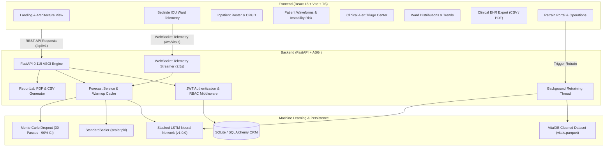

# VitalSync — Intelligent Patient Health Monitoring & LSTM Forecasting Suite

> [!CAUTION]
> **CLINICAL DISCLAIMER: DEMO AND RESEARCH BENCHMARK ONLY**  
> VitalSync is an engineering demonstration and academic deep-learning benchmark. **It is NOT certified as a medical device (SaMD) and is NOT intended for clinical diagnosis, patient management, or life-critical decision making.** Real-world clinical deployment requires institutional review board (IRB) approval, rigorous prospective clinical trials, and compliance with patient privacy and de-identification regulations (e.g., HIPAA Safe Harbor, GDPR).

VitalSync is an end-to-end patient telemetry and predictive vital-sign forecasting web application. The platform ingests continuous multi-parameter physiological streams (Heart Rate, Systolic BP, Diastolic BP), renders real-time bedside telemetry, detects threshold breaches, and projects 12-minute forward physiological trajectories with 90% uncertainty confidence bands using a stacked Long Short-Term Memory (LSTM) neural network with Monte Carlo Dropout.

---

## Architecture Overview



---

## Directory Structure

```
VitalSync/
├── .dockerignore               # Container build exclusions
├── .env.example                # Canonical environment variable template
├── .gitignore                  # Git tracking exclusions
├── Dockerfile                  # Unified single-container production image
├── Dockerfile.backend          # Backend & ML service container definition
├── Dockerfile.frontend         # Frontend static SPA & Nginx container
├── docker-compose.yml          # Multi-container orchestration definition
├── Makefile                    # Cross-platform development and automation targets
├── README.md                   # Complete system documentation and guides
├── requirements.txt            # Python dependencies (TensorFlow, FastAPI, etc.)
│
├── backend/                    # FastAPI ASGI application
│   ├── app/
│   │   ├── api/                # REST endpoints & WebSocket routing
│   │   │   ├── v1/             # Versioned routers (auth, patients, vitals, alerts, etc.)
│   │   │   ├── health.py       # Healthcheck endpoint (/health)
│   │   │   └── websockets.py   # High-throughput WebSocket telemetry engine
│   │   ├── core/               # App configuration, SQLite engine, and JWT security
│   │   ├── models/             # SQLAlchemy ORM database models
│   │   ├── schemas/            # Pydantic v2 validation and serialization schemas
│   │   ├── services/           # Forecast cache, inference, and reporting engines
│   │   └── main.py             # FastAPI entrypoint and lifespan lifecycle
│   └── tests/                  # Pytest test suite (21 unit and integration tests)
│
├── frontend/                   # React 18 + Vite + TypeScript web application
│   ├── src/
│   │   ├── components/         # Reusable design tokens, cards, modals, and layouts
│   │   │   ├── auth/           # ProtectedRoute and RBAC gatekeeper
│   │   │   ├── common/         # Card, Badge, Modal, ToastContainer, LoadingSkeleton
│   │   │   └── layout/         # AppLayout, Header, and Sidebar
│   │   ├── pages/              # 11 fully functional clinical web pages
│   │   ├── services/           # Typed REST client (api.ts) & WebSocket hook
│   │   ├── store/              # Zustand state stores (Auth, App, Toast)
│   │   ├── types/              # Domain interfaces and API payload types
│   │   ├── App.tsx             # React Router routing tree
│   │   └── main.tsx            # React application mount
│   ├── nginx.conf              # Production Nginx reverse-proxy configuration
│   └── package.json            # Node.js dependencies and build scripts
│
├── ml/                         # Machine learning training & inference pipeline
│   ├── data/
│   │   ├── raw/                # Raw clinical telemetry ingestion directory
│   │   └── processed/          # Parquet datasets (vitals.parquet, SOURCE.txt)
│   ├── models/                 # Serialized Keras LSTM (.keras) and scikit-learn Scaler (.pkl)
│   ├── notebooks/              # Jupyter notebook mirrors for EDA and model tuning
│   ├── reports/                # Evaluation reports (metrics.json, residual plots)
│   ├── collect_data.py         # VitalDB download and cleaning pipeline
│   ├── generate_synthetic.py   # Fallback synthetic circadian vitals generator
│   ├── predict.py              # Reusable inference engine with Monte Carlo Dropout
│   └── train.py                # Patient-split cross-validation and LSTM training
│
└── scripts/                    # Automation and verification utilities
    ├── dev.py                  # Concurrent backend and frontend launcher
    ├── seed.py                 # SQLite database seeder (demo users, patients, vitals)
    ├── setup.py                # Environment bootstrapper (venv, pip, npm, seed)
    ├── test.py                 # Integrated test runner (pytest + tsc + vite build)
    ├── verify_e2e_playwright.cjs # Automated 13-flow browser verification suite
    ├── verify_frontend_proxy.py  # Frontend reverse proxy check
    └── verify_live_api.py      # Live REST & WebSocket endpoint audit
```

---

## Data Provenance & Real vs. Synthetic Statement

VitalSync was built and benchmarked strictly on **real clinical patient data**.

- **Primary Clinical Dataset**: **VitalDB Open Dataset**
  - **Source Institution**: Seoul National University Hospital (SNUH), Department of Anesthesiology and Pain Medicine.
  - **Citation**: Lee HC, Park Y, Yoon SB, et al. *VitalDB, a high-fidelity multi-parameter vital signs database in surgical patients*. Scientific Data 9, 279 (2022).
  - **License**: Creative Commons Attribution 4.0 International (CC BY 4.0).
  - **Ingested Tracks**:
    - `Solar8000/HR`: Heart rate from continuous bedside electrocardiography (bpm).
    - `Solar8000/ART_SBP`: Arterial line invasive systolic blood pressure (mmHg).
    - `Solar8000/ART_DBP`: Arterial line invasive diastolic blood pressure (mmHg).
    - `Solar8000/NIBP_SBP` & `NIBP_DBP`: Non-invasive cuff blood pressure fallback channels.
  - **Ingested Cohort**: 217 real surgical and critical care patients, resampled to uniform 1-minute intervals (61,745 validated observations, 0 missing values, minimum 3.0 continuous hours per patient).
  - **Storage Location**: `/ml/data/processed/vitals.parquet` and documented in `/ml/data/processed/SOURCE.txt`.

- **Fallback Synthetic Generator**:
  - A fallback generator is provided in [ml/generate_synthetic.py](file:///d:/Projects/VitalSync/ml/generate_synthetic.py). It models multi-day patient trajectories with circadian sinusoids, per-patient baseline variances, correlated random-walk drifts, high-frequency measurement noise, transient physiological spikes, and sustained pathophysiological crises (e.g., septic shock, malignant hypertension).
  - Output is saved separately to `/ml/data/processed/vitals_synthetic.parquet`.
  - **Production State**: The active database and LSTM neural network were trained and populated exclusively on the **real VitalDB dataset**.

---

## Machine Learning Results & Benchmarks

The model was trained using strict **patient-level splitting** (70% train / 15% validation / 15% test; 151 train patients, 32 validation patients, 34 holdout test patients) to prevent data leakage across sliding time windows.

- **Lookback Window**: 60 minutes (60 historical steps).
- **Forecast Horizon**: 12 minutes (12 future steps).
- **Architecture**:
  - `Input((60, 3))` -> `LSTM(128, return_sequences=True)` -> `Dropout(0.2)` -> `LSTM(64)` -> `Dropout(0.2)` -> `Dense(36)` -> `Reshape((12, 3))`.
  - Optimizer: Adam (`lr=1e-3`), Loss: MSE, EarlyStopping (`patience=5`), ReduceLROnPlateau (`factor=0.5, patience=3`).
- **Uncertainty Estimation**: 30 stochastic forward passes via Monte Carlo Dropout at inference time, yielding 5th and 95th percentiles (90% confidence bands).

### Benchmark Comparison on Unseen Test Patients (34 Patients, 7,049 Windows)

| Model | Overall MAE | Overall RMSE | Heart Rate MAE (BPM) | Systolic BP MAE (mmHg) | Diastolic BP MAE (mmHg) |
|---|:---:|:---:|:---:|:---:|:---:|
| **Moving Average (15-min)** | 7.40 | 11.38 | 3.97 | 11.85 | 6.38 |
| **Last Value (Persistence)** | 7.06 | 11.64 | 3.86 | 11.23 | 6.10 |
| **Gated Recurrent Unit (GRU)** | 6.67 | 10.24 | 3.84 | 10.63 | 5.54 |
| **Stacked LSTM (VitalSync)** | **6.54** | **10.16** | **3.80** | **10.31** | **5.52** |

*The Stacked LSTM demonstrates a **16.1% improvement in overall MAE** over the 15-minute moving average baseline and outperforms persistence across all three physiological channels.*

---

## Quick Start & Setup

### Prerequisites
- Python 3.10 or 3.11 with pip (or `uv`)
- Node.js (v18+) and npm
- GNU Make (optional, scripts can be executed directly via Python)
- Docker & Docker Compose (optional for containerized deployment)

### 1. Automated Setup & Database Seeding
Run `make setup` (or `python scripts/setup.py`). This command:
1. Copies `.env.example` to `.env` if not present.
2. Creates the Python virtual environment (`.venv`) and installs all backend/ML dependencies.
3. Installs frontend npm dependencies.
4. Seeds SQLite (`vitalsync.db`) with demo staff accounts, 20 real patient profiles, 48 hours of 1-minute vitals, clinical alerts, and progress notes.

```bash
make setup
```

### 2. Start Development Servers
Run `make dev` (or `python scripts/dev.py`). This starts both servers concurrently:
- **FastAPI Backend**: `http://localhost:8000` (Swagger UI at `http://localhost:8000/docs`, health at `http://localhost:8000/health`)
- **Vite React Frontend**: `http://localhost:5173`

```bash
make dev
```

### 3. Run Test Suite
Executes the 21 backend unit/integration tests and validates the frontend TypeScript compilation and production build:

```bash
make test
```

---

## One-Command Docker Deployment

VitalSync includes production-ready container configurations supporting both multi-service Docker Compose and unified image builds.

### Run via Docker Compose
Builds the backend API container and the Nginx frontend reverse-proxy:

```bash
docker compose up --build -d
```
- Frontend application: `http://localhost:5173`
- Backend API & Docs: `http://localhost:8000`

To stop containers:
```bash
docker compose down
```

---

## Demo Healthcare Accounts

The database seed initializes three role-based accounts:

| Email | Password | Role | Clinical Access Scope |
|---|---|---|---|
| `admin@vitalsync.com` | `Admin123!` | `admin` | Full system control, background model retraining pipeline, account audit |
| `doctor@vitalsync.com` | `Doctor123!` | `doctor` | Inpatient admission/discharge, clinical notes, PDF reports, alert resolution |
| `nurse@vitalsync.com` | `Nurse123!` | `nurse` | Bedside telemetry monitoring, vital observations, alert acknowledgment |

---

## REST API & WebSocket Reference

All protected endpoints require a Bearer JWT passed in the `Authorization: Bearer <token>` header.

| Endpoint | Method | Role | Description |
|---|:---:|:---:|---|
| `/health` | `GET` | Public | System status, database connection, timestamp, version |
| `/api/v1/auth/login` | `POST` | Public | OAuth2 password flow login (form-data) |
| `/api/v1/auth/login/json` | `POST` | Public | JSON body login endpoint for SPA clients |
| `/api/v1/auth/register` | `POST` | Public | Self-registration for healthcare personnel |
| `/api/v1/auth/me` | `GET` | Authenticated | Retrieve profile, role, and permissions |
| `/api/v1/patients` | `GET` | Authenticated | Search, filter (status), sort, and paginate inpatients |
| `/api/v1/patients` | `POST` | Admin / Doctor | Admit new patient into clinical ward |
| `/api/v1/patients/{id}` | `GET` | Authenticated | Full patient demographics, room, and status |
| `/api/v1/patients/{id}` | `PUT` | Admin / Doctor | Modify inpatient room assignment, status, or conditions |
| `/api/v1/patients/{id}` | `DELETE`| Admin | Discharge patient and archive records |
| `/api/v1/patients/{id}/vitals` | `GET` | Authenticated | Historical physiological telemetry (`from`, `to`, `limit`) |
| `/api/v1/patients/{id}/forecast` | `GET` | Authenticated | 12-minute forward LSTM prediction with 90% confidence bands |
| `/api/v1/patients/{id}/notes` | `GET` | Authenticated | Retrieve clinical progress notes timeline |
| `/api/v1/patients/{id}/notes` | `POST` | Staff | Append observation or medication administration note |
| `/api/v1/alerts` | `GET` | Authenticated | Filter alerts by severity (`low`, `medium`, `high`, `critical`), resolution, and AI predicted flag |
| `/api/v1/alerts/{id}/acknowledge` | `POST` | Staff | Acknowledge active breach |
| `/api/v1/alerts/{id}/resolve` | `POST` | Staff | Mark alert resolved with provider clinical comment |
| `/api/v1/analytics/summary` | `GET` | Authenticated | Ward vital distributions (min/mean/max), 7-day severity aggregates |
| `/api/v1/reports/patient/{id}/export` | `GET` | Authenticated | Export formal clinical audit report (`format=csv` or `format=pdf`) |
| `/api/v1/model/info` | `GET` | Public | Model metadata, architecture, input shape, horizon |
| `/api/v1/model/metrics` | `GET` | Public | Evaluation metrics vs baseline persistence models |
| `/api/v1/model/retrain` | `POST` | Admin Only | Trigger asynchronous background model retraining |
| `/api/v1/model/retrain/status` | `GET` | Authenticated | Poll active retraining job status, epoch progress, and logs |
| `/ws/vitals/{patient_id}` | `WS` | Public | Real-time 2.5s physiological telemetry stream with broadcast alerts |

---

## Known Limitations

1. **Monolithic Relational Store**: The default deployment uses SQLite for zero-configuration local runs. High-frequency ICU telemetry across hundreds of active beds requires a distributed time-series database (e.g., PostgreSQL with TimescaleDB or InfluxDB).
2. **Fixed Predictive Horizon**: The current LSTM architecture uses a fixed 60-minute lookback and 12-minute horizon. Dynamic multi-step horizons (e.g., 30m, 1h, 4h) require sequence-to-sequence autoregressive decoding.
3. **Approximated Epistemic Uncertainty**: Monte Carlo Dropout approximates model uncertainty but is sensitive to dropout placement and does not substitute for full Bayesian neural networks or conformal prediction with guaranteed finite-sample coverage.
4. **Unimodal Feature Space**: The current model monitors three primary vital channels (HR, SBP, DBP). It does not ingest multi-lead 250Hz ECG waveforms, continuous arterial line pulsatile contours, lab blood gases ($PaO_2, pH, Lactate$), or medication infusion dosages.

---

## Future Improvements

1. **Advanced Temporal Architectures**: Benchmark against modern time-series foundation models and transformers, such as the Temporal Fusion Transformer (TFT), PatchTST, and TiDE.
2. **Unsupervised Anomaly Detection**: Integrate variational autoencoders (VAEs) or deep support vector data descriptions (Deep SVDD) to identify multivariate anomalous patterns before hard threshold violations occur.
3. **Multimodal Feature Integration**: Extend telemetry ingestion to include pharmacological administration records (vasopressors, inotropes, sedatives), fluid balances, and laboratory panels.
4. **Circadian & Contextual Conditioning**: Condition predictions on patient age, baseline comorbidities, surgical risk classification (ASA score), and diurnal rhythms.
5. **Distributed Asynchronous Worker Queue**: Decouple the retraining pipeline from the ASGI process using Celery or RQ backed by Redis, with artifact versioning managed through MLflow.
